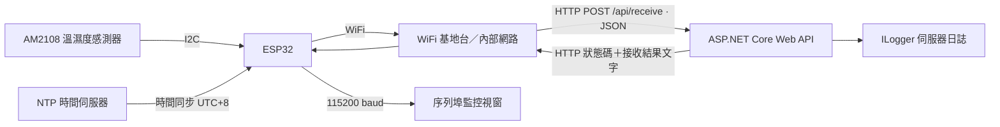
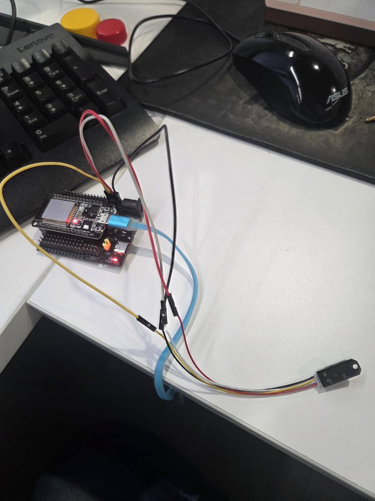
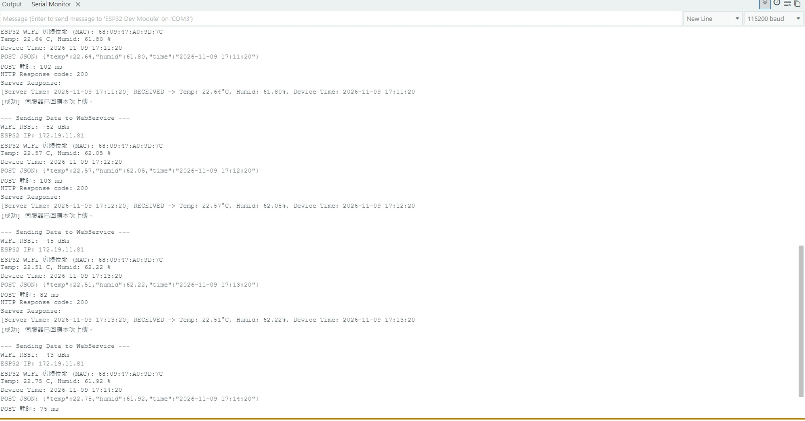

# ESP32 × AM2108 溫濕度資料上傳系統

使用 ESP32 讀取 AM2108 溫濕度感測器，透過 WiFi 每分鐘將資料以 JSON 格式傳送至 ASP.NET Core Web API。伺服器收到資料後，加入伺服器時間並回傳接收結果，由 ESP32 在序列埠監控視窗顯示，完成「感測、上傳、接收、回應」的物聯網資料傳輸流程。

## 系統架構



| 層級 | 元件 | 職責 |
| --- | --- | --- |
| 感測層 | AM2108 | 提供溫度與相對濕度資料 |
| 裝置層 | ESP32、Arduino 韌體 | 讀取感測器、同步時間、組合 JSON、定時上傳 |
| 網路層 | WiFi、TCP/IP、HTTP | 傳送資料並接收伺服器回應 |
| 服務層 | C#、ASP.NET Core、.NET 10 | 接收 JSON、產生接收結果、記錄日誌 |
| 觀察介面 | Serial、伺服器日誌 | 查看讀值、網路狀態與傳輸結果 |

## 主要功能

- 首次連上 WiFi 後立即傳送，其後每 60 秒啟動一次量測與上傳。
- 透過 I2C 讀取溫度與相對濕度，上傳時保留兩位小數。
- 使用 NTP 同步裝置時間，時區設定為台灣時間 UTC+8。
- 顯示 WiFi IP、MAC 實體位址與 RSSI，方便辨識設備及檢查連線。
- WiFi 斷線時暫停上傳，啟用自動重連，並每 15 秒主動嘗試重新連線。
- 分別設定 5 秒 TCP 連線逾時及 5 秒讀取逾時；整次操作並非固定在 5 秒內完成。
- 印出送出的 JSON、POST 耗時、HTTP 狀態碼、伺服器回應與連線錯誤訊息。
- 伺服器支援瀏覽器 GET 測試，以及感測資料或文字訊息的 POST 接收。

## 硬體接線

目前韌體使用一般 ESP32 的 GPIO21、GPIO22 作為 I2C 腳位。若使用不同板型，請調整程式中的 `SDA_PIN` 與 `SCL_PIN`。

| AM2108 模組 | ESP32 |
| --- | --- |
| VCC | 3.3V |
| GND | GND |
| SDA | GPIO21 |
| SCL | GPIO22 |

感測器介面沿用作品中的 `Adafruit_AHTX0` 函式庫；接線及模組相容性應以實際使用的硬體為準。

## 資料處理流程

1. ESP32 啟動序列埠與 I2C，初始化 AM2108。初始化失敗時顯示錯誤並停止後續流程。
2. 以 Station 模式連上指定 WiFi，輸出設備 MAC 與取得的 IP。
3. 連線成功後啟動 NTP 同步，最多先等待 10 秒。尚未同步時仍可上傳，時間欄位標記為 `Time_Not_Synchronized`。
4. 到達傳送時間後讀取感測器。若讀取失敗、數值不是有限數字或濕度不在 0～100% 範圍內，略過本次傳送。
5. 將溫度、濕度及裝置時間組成 JSON，傳送至 `/api/receive`。
6. API 將 JSON 對應至 `SensorData`，透過 `ILogger` 記錄接收內容，並產生含伺服器時間的文字回應。
7. ESP32 將 HTTP 狀態碼與回應內容印到序列埠，結束本次 HTTP 連線。

## API 格式

### 上傳溫濕度

```http
POST /api/receive
Content-Type: application/json
```

```json
{
  "temp": 22.50,
  "humid": 62.83,
  "time": "2026-11-09 16:40:11"
}
```

| 欄位 | 型別 | 說明 |
| --- | --- | --- |
| `temp` | number | 攝氏溫度 |
| `humid` | number | 相對濕度，單位 % |
| `time` | string | 裝置時間，格式為 `yyyy-MM-dd HH:mm:ss`；未同步時使用標記字串 |
| `msg` | string | 選用的文字訊息，供訊息模式使用 |

正常接收的回應範例，內容類型為 `text/plain; charset=utf-8`：

```text
[Server Time: 2026-11-09 16:40:11] RECEIVED -> Temp: 22.50°C, Humid: 62.83%, Device Time: 2026-11-09 16:40:11
```

API 也支援單獨傳送文字訊息：

```json
{
  "msg": "Hello from ESP32",
  "time": "2026-11-09 16:40:11"
}
```

若同時提供溫濕度及 `msg`，目前程式優先處理溫濕度。

### 瀏覽器連線測試

瀏覽器開啟 `/` 或 `/api/receive`，可取得以下形式的 GET 回應：

```text
HELLO 2026-11-09 16:40:11 (Please use POST with JSON for sensor data)
```

GET 可用來確認 HTTP 服務是否能回應；實際感測資料須使用 POST 傳送。

## 專案結構

```text
.
├── sketch_nov9b_copy_20261109170559.ino   # ESP32 韌體
├── ESP32_.jpg                           # 作品圖片
├── PostResult.jpg                       # 傳輸結果圖片
└── ESP32_hello/
    ├── ESP32_hello.slnx                 # .NET 方案
    └── ESP32_hello/
        ├── Controllers/
        │   ├── ReceiveController.cs     # 感測資料及訊息接收端點
        │   └── WeatherForecastController.cs # 範本端點
        ├── Program.cs                  # 註冊服務與 Controller 路由
        ├── ESP32_hello.csproj           # .NET 10 專案設定
        ├── appsettings.json            # 日誌等應用程式設定
        └── Properties/
            ├── launchSettings.json     # 開發環境監聽設定
            └── PublishProfiles/        # 發佈設定
```

## 執行方式

### ESP32

在 Arduino IDE 安裝 ESP32 開發板支援套件，以及 `Adafruit AHTX0`、`Adafruit Unified Sensor`、`Adafruit BusIO` 函式庫。開啟作品的 `.ino` 檔，填入自己的網路設定：

```cpp
const char* WIFI_SSID = "YOUR_WIFI_SSID";
const char* WIFI_PASSWORD = "YOUR_WIFI_PASSWORD";
const char* WEB_SERVICE_URL = "http://YOUR_SERVER_IP:889/api/receive";
```

選擇對應開發板及連接埠後上傳，將序列埠監控視窗設為 **115200 baud**。

### Web API

安裝 .NET 10 SDK，在儲存庫根目錄執行：

```powershell
dotnet run --project "ESP32_hello/ESP32_hello/ESP32_hello.csproj" --launch-profile http
```

目前 `http` 開發設定監聽 `http://0.0.0.0:5042`。若使用此方式測試，ESP32 的網址須設為 `http://伺服器實際IP:5042/api/receive`。

韌體原始設定使用 `889` 埠；若部署於 IIS，須將站台繫結及服務部署設定對應至此埠，並確保防火牆允許 ESP32 所在網路存取。`launchSettings.json` 的開發設定不等同 IIS 站台繫結。

## 作品展示





## 目前實作範圍

目前完成感測器讀取、WiFi 傳輸、API 接收與回應，以及裝置端和伺服器端的診斷輸出。後端透過 `ILogger` 記錄資料，實際日誌保留方式依執行環境及日誌提供者設定；目前沒有資料庫、歷史查詢或監控儀表板。

上傳失敗的資料不會在裝置保存或自動補送，下一個週期會讀取新數據。若後續需要完整歷史紀錄，可加入資料庫、裝置識別碼，以及具備去重機制的重送佇列。

目前 API 對缺少有效感測資料與訊息的請求，會以文字回應 `Error: No valid JSON data received.`，該分支仍使用預設 HTTP 200；因此正式整合時，不能只用 HTTP 200 判斷資料有效性。現有程式亦未設定 API 身分驗證，傳輸使用明文 HTTP，部署環境應依需求規劃存取控制與 HTTPS。
